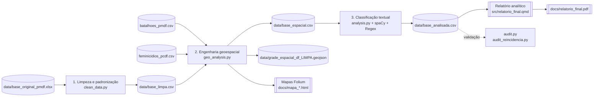

# Projeto Integrador-CEUB / PMDF: Análise Preditiva e Inteligência de Texto (Lei Maria da Penha)

Este projeto consiste em um pipeline (esteira) de Engenharia de Dados, Análise Geoespacial e Processamento de Linguagem Natural (NLP) aplicado a boletins de ocorrência da Polícia Militar do Distrito Federal. O objetivo é extrair inteligência, clusterizar áreas de risco e preparar a base para modelagem preditiva de Machine Learning.

## Arquitetura do Pipeline

O pipeline transforma os registros brutos da PMDF em uma base analítica enriquecida e, por
fim, em mapas e um relatório Quarto. O `main.py` executa as três etapas de tratamento em
sequência; os arquivos CSV funcionam como artefatos persistidos entre as etapas.

### Contratos de entrada e saída

| Etapa | Entrada principal | Transformações | Saída persistida |
|---|---|---|---|
| Limpeza | `base_original_pmdf.xlsx` | Leitura segura, extração de ano/mês/dia/hora e normalização do histórico | `base_limpa.csv` |
| Geoespacial | `base_limpa.csv` + bases auxiliares | Correção de coordenadas, `TURNO`, `TIPO_MORADIA`, reincidência por endereço, *spatial join* em células de 500 m | `base_espacial.csv`, mapas HTML e grade GeoJSON |
| NLP | `base_espacial.csv` | Regex para fatores de contexto e spaCy para tipos de violência, negação e desfecho | `base_analisada.csv` |
| Apresentação | `base_analisada.csv` | Agregações temporais, análise de fatores, reincidência e visualizações | `relatorio_final.pdf` |

### Governança e validação

- Os dados brutos e artefatos CSV ficam em `data/`, que não deve ser versionada por conter
  informações sensíveis e por seu tamanho.
- `src/utils/anonimizacao.py` contém a rotina de substituição de nomes, CPFs, telefones e
  matrículas por *placeholders*. Na implementação atual, ela ainda não é chamada pelo
  `main.py`; deve ser executada antes de qualquer compartilhamento ou exportação da base.
- `audit.py` e `audit_reincidencia.py` fazem validações independentes após a geração da base
  final, permitindo conferir contagens, flags e reincidência sem alterar os dados.

---

## Estrutura de Diretórios e Arquivos

### Raiz do Projeto
* `main.py`: O **Orquestrador**. Aciona os módulos de limpeza, geoespacial e NLP em sequência, medindo o tempo de execução e garantindo o fluxo correto dos dados.
* `requirements.txt`: Lista de dependências e bibliotecas Python necessárias para rodar o projeto.

### `src/` (Motores Principais)
* `clean_data.py`: Responsável por ler o Excel bruto, extrair variáveis de tempo (ano, mês, dia) e realizar a normalização básica do texto dos históricos (remoção de acentos e conversão para minúsculas). Gera a `base_limpa.csv`.
* `geo_analysis.py`: O **Motor Espacial**. Cria variáveis de contexto (`TURNO`, `TIPO_MORADIA`) com base em Regex. Isola coordenadas válidas, corrige erros de formatação (vírgulas/pontos) e realiza um cruzamento espacial (*Spatial Join*) com uma grade poligonal de 500x500m do DF. Retorna o `id_celula` para a base preservando todas as linhas originais (evitando perda de dados sem GPS). Gera a `base_espacial.csv` e o mapa interativo.
* `analysis.py`: O **Motor NLP**. Consome a base espacial e aplica a inteligência artificial (spaCy + Regex) em processamento de lote (`nlp.pipe`). Extrai flags cruciais como `v_fisica`, `flag_arma_fogo` e `flag_alcool`. Gera a `base_analisada.csv` final.
* `audit.py`: Script avulso de validação (*Ground Truthing*). Imprime um relatório no terminal com estatísticas vitais e amostras de texto classificado para garantir a integridade da pipeline.

### `src/utils/` (Ferramentas de Apoio)
Contém funções auxiliares importadas pelos motores principais:
* `anonimizador.py` *(ou o nome que vocês deram)*: Script crítico de segurança de dados (LGPD). Substitui nomes de vítimas, suspeitos, CPFs e matrículas por *placeholders* (`[NOME]`, `[CPF]`).
* `extracao_datetime.py`: Módulo modular para desmembrar a coluna 'data hora' em componentes úteis para análise de séries temporais.
* `nlp_engines.py`: Contém a lógica pesada do spaCy (lematização e análise de dependência sintática) para identificar menções a agressões e desambiguar falsos positivos (ex: "não houve agressão física").
* `read_file.py`: Função segura para ignorar cabeçalhos/rodapés falsos durante a leitura do Excel original.
* `report_plots.py`: Centraliza as funções responsáveis pela criação dos gráficos utilizados no relatório analítico, garantindo consistência visual e reutilização de código ao longo do projeto.
* `report_theme.py`: Define o tema gráfico institucional utilizado em todas as visualizações produzidas pelo projeto.
Este módulo configura parâmetros globais de estilo (principalmente via Matplotlib/Seaborn), garantindo identidade visual única e adequada para documentos formais.
Inclui definições como:
  - paleta de cores padronizada;
  - tipografia e tamanhos de fonte;
  - estilos de grade (grid);
  - espaçamentos e margens;

Este módulo abstrai a lógica de visualização, permitindo que os notebooks e scripts principais apenas forneçam os dados já processados, enquanto o próprio módulo controla:

### `data/` (Repositório de Dados)
*Não versionado no Git por questões de LGPD e tamanho.*
* Recebe a `base_original_pmdf.xlsx`.
* Armazena os artefatos intermediários (`base_limpa.csv`, `base_espacial.csv`) e a `base_analisada.csv` final.
* Contém a `grade_espacial_df_LIMPA.geojson` (usada pelo modelo de Machine Learning).

### `docs/` (Artefatos Visuais)
* `mapa_grade_preditiva.html`: Mapa coroplético interativo gerado via Folium, evidenciando as células de 500m com maior incidência criminal.

---

## Como Executar

1. Instale as dependências: `pip install -r requirements.txt`
2. Garanta que o arquivo `base_original_pmdf.xlsx` está na pasta `data/`.
3. Rode a esteira completa: `python main.py`
4. Valide a integridade dos dados gerados: `python src/audit.py`

## URL do Projeto 

https://lucas-gpetry.github.io/Projeto-Integrador---CEUB/
