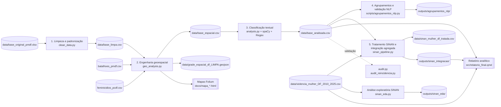

# Projeto Integrador-CEUB / PMDF: Análise Preditiva e Inteligência de Texto (Lei Maria da Penha)

Este projeto consiste em um pipeline (esteira) de Engenharia de Dados, Análise Geoespacial e Processamento de Linguagem Natural (NLP) aplicado a boletins de ocorrência da Polícia Militar do Distrito Federal. O objetivo é extrair inteligência, clusterizar áreas de risco e preparar a base para modelagem preditiva de Machine Learning.

## Arquitetura do Pipeline

O pipeline transforma os registros brutos da PMDF em uma base analítica enriquecida, mapas,
agrupamentos para validação e uma comparação agregada com notificações do SINAN. O `main.py`
executa automaticamente as cinco etapas em sequência; os arquivos CSV funcionam como
artefatos persistidos entre as etapas.



### Contratos de entrada e saída

| Etapa | Entrada principal | Transformações | Saída persistida |
|---|---|---|---|
| Limpeza | `base_original_pmdf.xlsx` | Leitura segura, extração de ano/mês/dia/hora e normalização do histórico | `base_limpa.csv` |
| Geoespacial | `base_limpa.csv` + bases auxiliares | Correção de coordenadas, `TURNO`, `TIPO_MORADIA`, reincidência por endereço, *spatial join* em células de 500 m | `base_espacial.csv`, mapas HTML e grade GeoJSON |
| NLP | `base_espacial.csv` | Regex para fatores de contexto e spaCy para tipos de violência, negação e desfecho | `base_analisada.csv` |
| Agrupamentos NLP | `base_analisada.csv` | Agrupamento por tipo de violência, fatores contextuais, desfecho, combinações de flags e endereço | `outputs/agrupamentos_nlp/` |
| SINAN × PMDF | `violencia_mulher_DF_2010_2025.csv` + `base_analisada.csv` | Padronização de datas/códigos SINAN, recorte de ocorrências no DF, perfil comparativo, sazonalidade, coocorrências e correlações mensais/defasadas | `sinan_mulher_df_tratada.csv`, `outputs/sinan_integracao/` |

### Governança e validação

- Os dados brutos e artefatos CSV ficam em `data/`, que não deve ser versionada por conter
  informações sensíveis e por seu tamanho.
- `src/utils/anonimizacao.py` contém a rotina de substituição de nomes, CPFs, telefones e
  matrículas por *placeholders*. Na implementação atual, ela ainda não é chamada pelo
  `main.py`; deve ser executada antes de qualquer compartilhamento ou exportação da base.
- `audit.py` e `audit_reincidencia.py` fazem validações independentes após a geração da base
  final, permitindo conferir contagens, flags e reincidência sem alterar os dados.
- `outputs/agrupamentos_nlp/` é uma saída local ignorada pelo Git, pois os arquivos de
  conferência reproduzem históricos e demais campos potencialmente sensíveis.
- A integração SINAN × PMDF não faz *join* de pessoas, endereços, protocolos ou casos. SINAN
  representa notificações de saúde, enquanto PMDF representa atendimentos/chamados policiais;
  a unidade comum é o mês de ocorrência. Reincidência por endereço no PMDF e `OUT_VEZES` no
  SINAN não são a mesma variável e não são correlacionadas.
- `outputs/sinan_integracao/` e a camada tratada SINAN são saídas locais ignoradas pelo Git.
  Consulte `docs/sinan_pmdf_metodologia.md` para os critérios e limites de interpretação.

---

## Relatório analítico

`src/relatorio_final.qmd` (Quarto) reúne os resultados das duas fontes. Todos os números do texto
são recalculados a cada renderização a partir de `data/` e `outputs/sinan_integracao/`.

| Seção | Fonte | Conteúdo |
|---|---|---|
| 1–7 | PMDF (2024) | Qualidade, padrões temporais e feriados, formas de violência, fatores de contexto e associações, desfecho e local, repetição por endereço, distribuição espacial, batalhões e feminicídios por RA |
| 8 | SINAN (2010–2025, foco em 2024) | Análise exploratória (ver abaixo) |
| 9 | SINAN × PMDF | Comparação agregada por mês e por indicador |
| 10–11 | Ambas | Limitações, conclusões e próximos passos |

Saídas: `src/relatorio_final.html` e `src/relatorio_final.pdf`; a versão aprovada do PDF é copiada
para `docs/relatorio_final.pdf`. Sem `data/feminicidios_pcdf.csv`, a subseção de feminicídios é
substituída por um aviso, e o restante do relatório é renderizado normalmente.

## Análise exploratória do SINAN

`src/sinan_eda.py` descreve as notificações do SINAN pelo mesmo roteiro da análise da PMDF, com as
mesmas funções de `report_stats.py` e `report_figures.py`. O resultado está no relatório, seção
**Análise exploratória do SINAN**, e também pode ser gerado de forma avulsa (fora do `main.py`):

```bash
python src/sinan_eda.py                                    # coorte primária, foco em 2024
python src/sinan_eda.py --ano 2023                         # outro ano de foco
python src/sinan_eda.py --coorte coorte_pmdf_sensibilidade # inclui LES_AUTOP ignorado/vazio
```

A saída em `outputs/sinan_eda/` (ignorada pelo Git) traz `tabelas/*.csv`, `figuras/*.png` e
`resumo_eda_sinan.md`, com os principais números já redigidos.

**Conteúdo:** qualidade e completude da ficha; série 2010–2025 e composição das formas de violência
por ano; mês, dia da semana, hora e feriados; perfil da vítima (idade, raça/cor, escolaridade,
deficiência); formas de violência, meios de agressão e tipos de violência sexual; vínculo e perfil do
autor; local; motivação; encaminhamentos; razões de prevalência brutas e ajustadas por faixa etária.
A concentração por unidade notificadora é calculada quando a exportação traz `ID_UNIDADE`.

**Decisões metodológicas:**

- **Coorte:** a mesma de `sinan_pipeline.py`: mulheres, ocorrência no DF (`ID_MN_OCOR = 530010`),
  violência não autoprovocada confirmada (`LES_AUTOP = 2`), 2010–2025.
- **Denominador:** proporções entre respostas válidas (1 = sim, 2 = não); o percentual de ignorado
  (9) ou vazio é reportado ao lado. Nas flags da PMDF, "não" significa "não identificado"; no SINAN,
  "não" e "ignorado" são respostas distintas.
- **Datas imputadas:** o dia 1 do mês tem cerca de três vezes a frequência dos demais dias, sinal de
  data digitada quando só o mês ou o ano são conhecidos. Essas datas ficam fora das análises por dia
  da semana e feriado (e 01/01 também da mensal), e o número de dias esperado é corrigido.
- **Hora:** preenchida em cerca de um terço das notificações; 00:00 é tratado como valor-padrão.
- **Notificação tardia:** cerca de 30% das notificações chegam após 30 dias (mais na violência
  sexual), e parte das ocorrências de um ano só é notificada no seguinte; o último ano da série é
  preliminar.
- **Recorte doméstico adulto:** vítimas com 18 anos ou mais e autor parceiro, ex-parceiro ou familiar
  (`recorte_domestico`), o subconjunto mais próximo do escopo da PMDF. Quase 30% das vítimas no
  SINAN têm menos de 18 anos, e a violência sexual concentra-se nessa faixa.
- **Associações:** ajustadas por faixa etária (Mantel-Haenszel), o principal fator de confusão no
  SINAN, assim como o tamanho do histórico o é na PMDF.

---

## Estrutura de Diretórios e Arquivos

### Raiz do Projeto
* `main.py`: O **Orquestrador**. Aciona os módulos de limpeza, geoespacial, NLP, agrupamentos e integração SINAN em sequência, medindo o tempo de execução e garantindo o fluxo correto dos dados.
* `requirements.txt`: Lista de dependências e bibliotecas Python necessárias para rodar o projeto.

### `src/` (Motores Principais)
* `clean_data.py`: Responsável por ler o Excel bruto, extrair variáveis de tempo (ano, mês, dia) e realizar a normalização básica do texto dos históricos (remoção de acentos e conversão para minúsculas). Gera a `base_limpa.csv`.
* `geo_analysis.py`: O **Motor Espacial**. Cria variáveis de contexto (`TURNO`, `TIPO_MORADIA`) com base em Regex. Isola coordenadas válidas, corrige erros de formatação (vírgulas/pontos) e realiza um cruzamento espacial (*Spatial Join*) com uma grade poligonal de 500x500m do DF. Retorna o `id_celula` para a base preservando todas as linhas originais (evitando perda de dados sem GPS). Gera a `base_espacial.csv` e o mapa interativo.
* `analysis.py`: O **Motor NLP**. Consome a base espacial e aplica a inteligência artificial (spaCy + Regex) em processamento de lote (`nlp.pipe`). Extrai flags cruciais como `v_fisica`, `flag_arma_fogo` e `flag_alcool`. Gera a `base_analisada.csv` final.
* `sinan_pipeline.py`: Mantém o CSV SINAN bruto intacto, acrescenta campos analíticos e produz coortes de violência interpessoal para comparação mensal agregada com PMDF. Também gera perfil de qualidade, definições, séries anuais/mensais, coocorrências, sazonalidade, reincidência conceitual e correlações Pearson/Spearman, inclusive com defasagens e ajuste para múltiplos testes.
* `sinan_eda.py`: Análise exploratória do SINAN no mesmo formato da análise PMDF: qualidade e completude da ficha, série 2010–2025, mês/dia da semana/hora/feriados, perfil da vítima, formas e meios de violência, vínculo e perfil do autor, local, encaminhamentos, razões de prevalência brutas e ajustadas por faixa etária e concentração por unidade notificadora. Executar com `python src/sinan_eda.py [--ano 2024] [--coorte coorte_pmdf_sensibilidade]`; gera tabelas, figuras e `resumo_eda_sinan.md` em `outputs/sinan_eda/`.
* `audit.py`: Script avulso de validação (*Ground Truthing*). Imprime um relatório no terminal com estatísticas vitais e amostras de texto classificado para garantir a integridade da pipeline.

### `scripts/` (Agrupamentos e validação)
* `agrupamentos_nlp.py` (ou `agrupamentos_nlp.ps1` no Windows): Lê a `base_analisada.csv` e gera arquivos CSV separados por cada categoria NLP, combinações de flags, agrupamento por endereço e, na versão Python, a planilha consolidada `agrupamentos_nlp.xlsx` em `outputs/agrupamentos_nlp/`. As saídas são gravadas em UTF-8 com BOM para abertura correta no Excel; o fallback PowerShell também corrige textos legados em UTF-8 interpretados como Latin-1.

### `src/utils/` (Ferramentas de Apoio)
Contém funções auxiliares importadas pelos motores principais:
* `anonimizador.py` *(ou o nome que vocês deram)*: Script crítico de segurança de dados (LGPD). Substitui nomes de vítimas, suspeitos, CPFs e matrículas por *placeholders* (`[NOME]`, `[CPF]`).
* `extracao_datetime.py`: Módulo modular para desmembrar a coluna 'data hora' em componentes úteis para análise de séries temporais.
* `nlp_engines.py`: Contém a lógica pesada do spaCy (lematização e análise de dependência sintática) para identificar menções a agressões e desambiguar falsos positivos (ex: "não houve agressão física").
* `read_file.py`: Função segura para ignorar cabeçalhos/rodapés falsos durante a leitura do Excel original.
* `report_plots.py`: Centraliza as funções responsáveis pela criação dos gráficos utilizados no relatório analítico, garantindo consistência visual e reutilização de código ao longo do projeto.
* `report_theme.py`: Define o tema gráfico institucional utilizado em todas as visualizações produzidas pelo projeto.
Este módulo configura parâmetros globais de estilo (principalmente via Matplotlib/Seaborn), garantindo identidade visual única e adequada para documentos formais.
Inclui definições como:
  - paleta de cores padronizada;
  - tipografia e tamanhos de fonte;
  - estilos de grade (grid);
  - espaçamentos e margens;

Este módulo abstrai a lógica de visualização, permitindo que os notebooks e scripts principais apenas forneçam os dados já processados, enquanto o próprio módulo controla:

### `data/` (Repositório de Dados)
*Não versionado no Git por questões de LGPD e tamanho.*
* Recebe a `base_original_pmdf.xlsx`.
* Recebe `violencia_mulher_DF_2010_2025.csv`, exportação SINAN de notificações de violência contra mulheres.
* Armazena os artefatos intermediários (`base_limpa.csv`, `base_espacial.csv`) e a `base_analisada.csv` final.
* Armazena localmente `sinan_mulher_df_tratada.csv`; o arquivo-fonte SINAN não é alterado.
* Recebe `batalhoes_pmdf.csv` (colunas `Nome do Batalhão`, `RA`, `Latitude`, `Longitude`) e `feminicidios_pcdf.csv` (PCDF; separador `;`, Latin-1). Sem a base de feminicídios, a subseção correspondente do relatório é substituída por um aviso.
* Contém a `grade_espacial_df_LIMPA.geojson` (usada pelo modelo de Machine Learning).

### `docs/` (Artefatos Visuais)
* `mapa_grade_preditiva.html`: Mapa coroplético interativo gerado via Folium, evidenciando as células de 500m com maior incidência criminal.
* `relatorio_final.pdf`: Versão aprovada do relatório analítico (PMDF, EDA do SINAN e integração SINAN × PMDF).
* `sinan_pmdf_metodologia.md`: Critérios da integração SINAN × PMDF e limites de interpretação.

---

## Como Executar

1. Use **Python 3.12** (ou 3.11): spaCy 3.7 com `numpy<2` não compila no Python 3.13.
   Crie o ambiente com `python3.12 -m venv .venv` e instale as dependências: `pip install -r requirements.txt`
2. Garanta que o arquivo `base_original_pmdf.xlsx` está na pasta `data/`.
3. Garanta também que `violencia_mulher_DF_2010_2025.csv`, `batalhoes_pmdf.csv` e `feminicidios_pcdf.csv` estão em `data/`.
4. Rode a esteira completa, incluindo agrupamentos NLP e integração SINAN: `python main.py`
5. Valide a integridade dos dados gerados: `python src/audit.py`
6. (Opcional) Gere as tabelas e figuras avulsas da EDA do SINAN: `python src/sinan_eda.py`
7. Renderize o relatório (HTML e PDF) a partir de `src/`, com o Python do ambiente:
   `QUARTO_PYTHON=../.venv/bin/python quarto render relatorio_final.qmd`
8. Rode os testes: `python -m unittest discover -s tests`

## URL do Projeto 

https://lucas-gpetry.github.io/Projeto-Integrador---CEUB/
